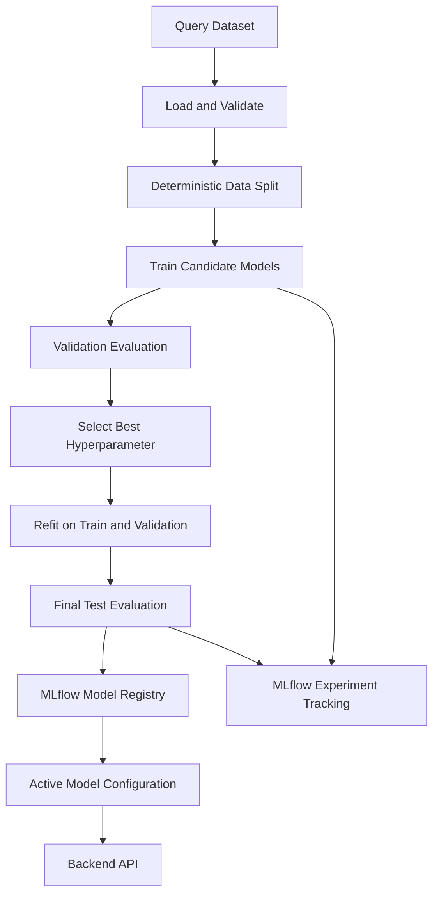
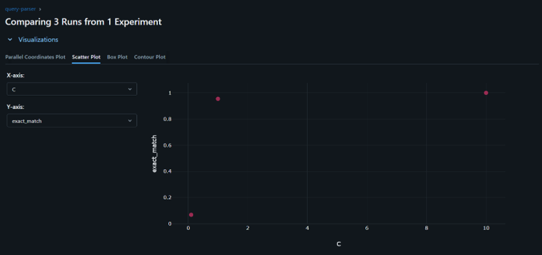
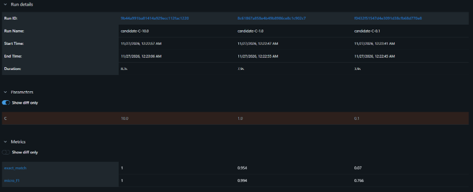
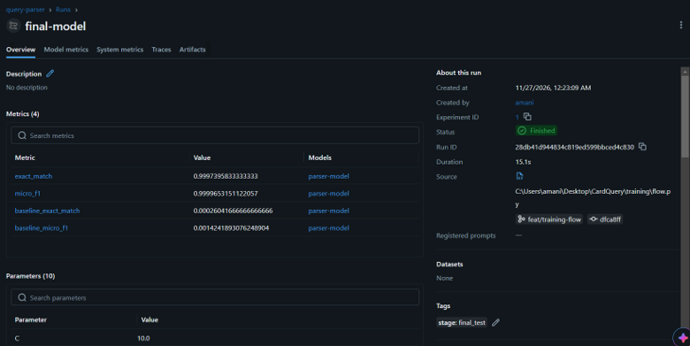
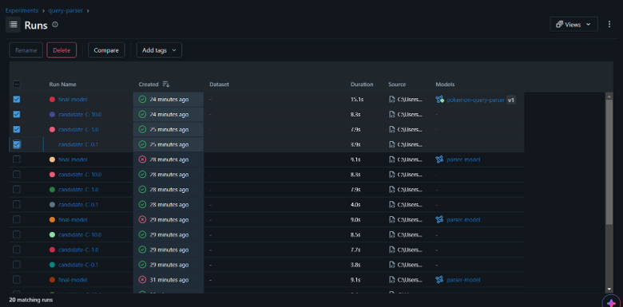
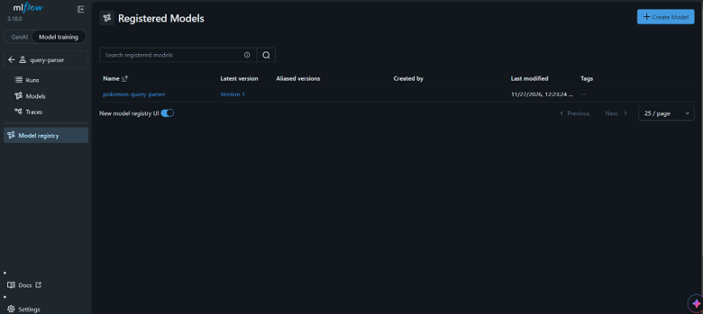

# CardQuery — Training Workflow (Part 5)

## Overview

This component implements the automated training and experiment
tracking pipeline for CardQuery, a natural-language Pokémon card
search application.

The workflow uses the hybrid TF-IDF and logistic regression
parser developed in Part 2. Prefect orchestrates the training
process, while MLflow tracks experiments, stores model artifacts
and registers the final model for deployment.

## Architecture



## Tools

| Tool | Purpose |
|---|---|
| Prefect | Training workflow orchestration |
| MLflow | Experiment tracking and model registry |
| scikit-learn | Query parser training |
| Pandas | Model input and output interfaces |
| Pytest | Unit and integration testing |
| Ruff | Code linting and formatting |
| Docker | Reproducible execution |
| Docker Compose | Service orchestration |
| SQLite | Persistent MLflow metadata storage |

## Directory Structure

```text
training/
    __init__.py
    adapter.py
    bootstrap.py
    fake_parser.py
    flow.py
    mlflow_model.py
    smoke_test.py
    Dockerfile
    requirements.txt
    README.md
    screenshots/
tests/
    test_flow.py
docker-compose.training.yml
```

## Training Data

The workflow uses `data/query_examples.csv`, supplied by
Part 2. Each row contains a natural-language query and its
corresponding JSON-encoded filters.

The dataset contains 19,196 labeled queries.

| Split | Samples |
|---|---:|
| Training | 11,516 |
| Validation | 3,840 |
| Test | 3,840 |

The split uses seed 42 and follows the team's deterministic
splitting protocol. Duplicate queries are handled by the
parser's data utilities, and overlap with the unseen traffic
datasets is checked before training.

## Training Workflow

The Prefect flow performs the following steps:

1. Load and validate labeled query examples.
2. Check for data leakage.
3. Generate reproducible training, validation and test sets.
4. Train three candidate models with different C values.
5. Track parameters, metrics and artifacts in MLflow.
6. Select the best candidate using validation exact match,
   followed by micro F1 and smaller C as tie-breakers.
7. Refit the selected model on training and validation data.
8. Evaluate the final model on the held-out test set.
9. Compare performance against a majority-label baseline.
10. Package and register the final model in MLflow.

## Experiment Results

The following candidate validation scores are rounded to
the precision displayed in the MLflow interface.

| C | Exact Match | Micro F1 |
|---:|---:|---:|
| 0.1 | 0.070 | 0.766 |
| 1.0 | 0.954 | 0.994 |
| 10.0 | 1.000 | 1.000 |

The selected hyperparameter was C = 10.0.





### Final Test Performance

| Metric | Score |
|---|---:|
| Exact match | 0.9997396 |
| Micro F1 | 0.9999653 |

Exact match measures whether the entire predicted filter
dictionary matches the expected label. Micro F1 measures
performance across individual filter-value pairs.

The final model outperformed the majority-label baseline.



## MLflow Experiment Tracking

Every candidate and final training run records:

- Regularization parameter C
- Random seed
- Parser architecture
- Numeric rules version
- TF-IDF n-gram range
- Dataset split sizes
- SHA-256 dataset hash
- Evaluation metrics
- Serialized model artifacts



## Model Registry

The final parser is registered as:

`pokemon-query-parser`

The MLflow PythonModel wrapper packages the parser artifact,
required source code and pinned inference dependencies.



### Prediction Interface

Input: a pandas DataFrame with one column named `query`.

Output: a pandas DataFrame with one column named
`filters_json`, preserving input row count and order.

Example:

```python
import mlflow
import pandas as pd

model = mlflow.pyfunc.load_model(
    "models:/pokemon-query-parser/1"
)

predictions = model.predict(
    pd.DataFrame({
        "query": ["fire charizards with at least 150 hp"]
    })
)

print(predictions)
```

Expected decoded prediction:

```json
{
    "name": "Charizard",
    "types": ["Fire"],
    "hp_min": 150,
    "hp_max": null,
    "rarity": null,
    "year_min": null,
    "year_max": null
}
```

Replace the version number with the registered version
returned by the training workflow when necessary.

## Local Setup

Python 3.11 is required for the team's runtime environment.

From the repository root:

```bash
python -m pip install -r training/requirements.txt
```

Start MLflow in a separate terminal:

```bash
mlflow server --backend-store-uri sqlite:///mlflow.db --host 127.0.0.1 --port 5001
```

Set the tracking URI.

Windows PowerShell:

```powershell
$env:MLFLOW_TRACKING_URI="http://127.0.0.1:5001"
```

Linux/macOS:

```bash
export MLFLOW_TRACKING_URI=http://127.0.0.1:5001
```

Run the training pipeline:

```bash
python -m training.flow
```

The MLflow interface is available at:

http://localhost:5001

## Docker Setup

From the repository root:

```bash
docker compose -f docker-compose.training.yml up --build
```

The Compose configuration starts the MLflow server and
waits for its health check before launching the training
container.

Training runs as a one-shot job. An exit code of 0
indicates successful completion.

The MLflow server remains running, with its database
and artifacts stored in a persistent Docker volume.

Check container status:

```bash
docker compose -f docker-compose.training.yml ps -a
```

Stop the services:

```bash
docker compose -f docker-compose.training.yml down
```

Do not use the `-v` flag unless persistent MLflow
data should also be removed.

## Backend Integration

The training bootstrap automatically writes:

`artifacts/active_model.json`

Example:

```json
{
    "model_uri": "models:/pokemon-query-parser/1",
    "model_version": "1"
}
```

The backend reads this configuration to load the exact
registered model version.

Inside Docker, the MLflow tracking URI is:

`http://mlflow:5000`

From the host machine, MLflow is accessible at:

`http://localhost:5001`

The integrator must ensure that the API starts after
successful completion of the training bootstrap and
has access to the active model configuration.

## Testing

The training component includes 10 unit tests and
one opt-in integration test.

The tests cover:

- Dataset loading
- Invalid dataset handling
- Dataset split sizes
- Reproducibility
- Data leakage between splits
- Hyperparameter selection
- Micro F1 tie-breaking
- Smaller-C tie-breaking
- Fake parser serialization
- Invalid query handling
- End-to-end training, registration and model reload

Run unit tests:

```bash
python -m pytest tests/test_flow.py -v
```

Enable integration testing in PowerShell:

```powershell
$env:RUN_MLFLOW_INTEGRATION="1"
python -m pytest tests/test_flow.py -v
Remove-Item Env:RUN_MLFLOW_INTEGRATION
```

The integration test uses the fake parser and an isolated
temporary SQLite-backed MLflow registry. It does not
modify the application model registry.

### Test Results

- 10 unit tests passed.
- 1 integration test passed.
- 0 failed tests.
- Ruff linting passed.

See [test execution logs](screenshots/pytest_results.txt).

## Smoke Testing

The registered model can be tested using:

```bash
python -m training.smoke_test
```

The smoke test uses model version 1 and verifies the
prediction schema, batch output size and golden query.

See [smoke test output](screenshots/model_smoke_test.txt).

## Code Quality

```bash
python -m ruff check training tests/test_flow.py
python -m ruff format --check training tests/test_flow.py
```

## Limitations

The model is trained on a synthetic labeled query dataset.
High held-out performance does not necessarily generalize
to arbitrary real-world queries.

During smoke testing, the query "water pokemon" returned
an unintended Pokémon name, Croconaw, while correctly
identifying the Water type.

This is a query parser generalization limitation rather
than a training orchestration or model registry failure.

The fake parser is intended exclusively for testing
workflow mechanics and must not be used in production.

MLflow emits a non-blocking warning about prediction
method type hints. All training and integration tests
completed successfully despite this warning.

## Additional Evidence

- [Containerized Prefect workflow](screenshots/prefect_workflow.txt)
- [Docker container status](screenshots/docker_status.txt)
- [Automated test results](screenshots/pytest_results.txt)
- [Registered model predictions](screenshots/model_smoke_test.txt)
